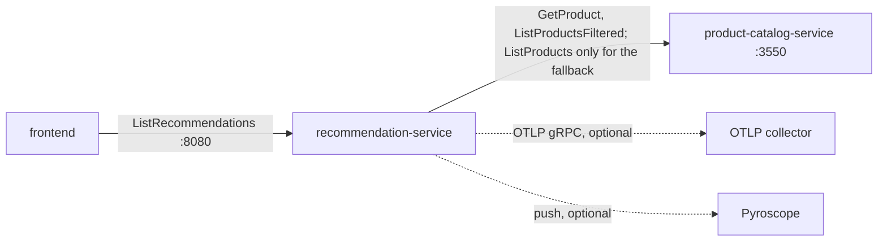

# Architecture

## Context



The service is stateless and has no database. Its only dependency is the product catalog, reached over a lazy gRPC channel, so it starts even when the catalog is down. The caller and the catalog RPCs were checked in the code (`src/ranking.py`, `src/server.py`); that the frontend is the only caller is taken from the README.

## Flow of one request

```mermaid
sequenceDiagram
    participant FE as frontend
    participant RE as recommendation-service
    participant CA as product-catalog-service
    FE->>RE: ListRecommendations(product_ids)
    loop each distinct id, at most 10
        RE->>CA: GetProduct (department of the product)
    end
    loop each collected department (cached 60 s)
        RE->>CA: ListProductsFiltered(department, rating desc, 50 per page, at most 3 pages)
    end
    Note over RE: merge, drop the given ids, sort by rating, review count, id; first 5
    RE-->>FE: product ids
    Note over RE,CA: any failure: log a warning and fall back to ListProducts + random sample
```

The ranking is deterministic and `user_id` plays no part. The details (cache, edge cases) are in the README section "Recommendation logic".

## Components

| File | Role |
|---|---|
| `src/server.py` | gRPC server (`RecommendationService` and `Health` on one port), reflection, the random fallback, SIGTERM handling |
| `src/ranking.py` | resolve, candidates (60 s cache on a monotonic clock), rank |
| `src/telemetry.py`, `logsetup.py`, `runtime_metrics.py` | telemetry contract, JSON logs with trace ids, Python runtime metrics |
| `proto/` | `recommendation.proto` (with the client definition of the catalog calls it makes) and `health.proto`; the stubs are generated in the Docker build |

## Decisions

[ADR 1](adr/0001-rank-by-category-rating-with-random-fallback.md).
